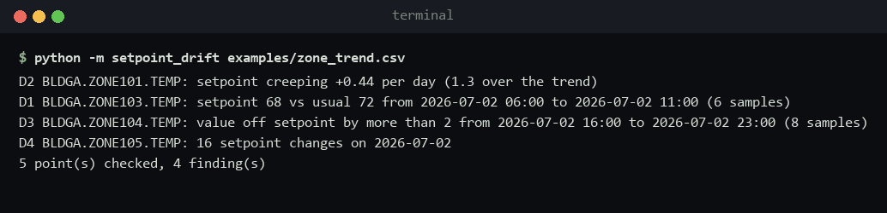

<p align="center"></p>

# setpoint-drift-checker

A command-line tool that reads a building trend CSV and flags setpoint drift: an offset, steady creep, a loop that does not reach its setpoint, and setpoint chatter.



## What it is for

Zone and supply air setpoints get changed by occupants, overrides and well meaning operators, and they are rarely changed back. Over weeks the building runs warmer, colder or less stable than designed, and the energy cost shows up before anyone finds the cause. Facility engineers, building automation technicians and energy managers can run this on an exported trend file to find the points that need a look. It flags four patterns: an offset from the usual setpoint, steady creep, a loop that does not reach its setpoint, and a setpoint that is changed too often.

## Install

```
git clone <this repo> && cd setpoint-drift-checker
python -m pip install -r requirements.txt
python -m pytest -q
```

## How to use

Input columns: `timestamp, point, setpoint, value` (one row per point per time, ISO timestamps). Exit code is 1 when findings exist, 0 when none, 2 on bad input. The sample file is three invented days of hourly data for five zones in Building A; zone 102 is healthy and each other zone carries one injected problem.

| I want to | Command |
|---|---|
| Check a trend file with the default limits | `python -m setpoint_drift examples/zone_trend.csv` |
| Change how far from the usual setpoint counts as an offset (default 1.0) | `python -m setpoint_drift examples/zone_trend.csv --offset 2` |
| Change the slope per day that counts as creep (default 0.25) | `python -m setpoint_drift examples/zone_trend.csv --creep-per-day 0.5` |
| Change how far the value may sit from the setpoint (default 2.0) | `python -m setpoint_drift examples/zone_trend.csv --tracking-band 3` |
| Change how many samples in a row make a run (default 4) | `python -m setpoint_drift examples/zone_trend.csv --min-run 6` |
| Change how many setpoint changes per day count as chatter (default 4) | `python -m setpoint_drift examples/zone_trend.csv --max-changes-per-day 8` |

Worked example:

```
python -m setpoint_drift examples/zone_trend.csv
```

Output:

```
D2 BLDGA.ZONE101.TEMP: setpoint creeping +0.44 per day (1.3 over the trend)
D1 BLDGA.ZONE103.TEMP: setpoint 68 vs usual 72 from 2026-07-02 06:00 to 2026-07-02 11:00 (6 samples)
D3 BLDGA.ZONE104.TEMP: value off setpoint by more than 2 from 2026-07-02 16:00 to 2026-07-02 23:00 (8 samples)
D4 BLDGA.ZONE105.TEMP: 16 setpoint changes on 2026-07-02
5 point(s) checked, 4 finding(s)
```

## How it works

- Samples are grouped by point and sorted by time. Rows with a blank or non numeric setpoint or value are skipped.
- D1 offset: the usual setpoint is the median over the trend. A run of at least `min_run` samples more than `offset` away from it is reported with start, end and length.
- D2 creep: a least squares line through setpoint against time gives units per day. It is reported when the slope is at least `creep_per_day` and the total movement over the trend exceeds `offset`.
- D3 tracking: a run of at least `min_run` samples where the value is more than `tracking_band` away from the setpoint.
- D4 chatter: the number of setpoint changes per calendar day, reported when it passes `max_changes_per_day`.

## Limits

- The usual setpoint is the median, so a setpoint that was wrong for most of the trend will not show as an offset.
- Thresholds are plain numbers in the trend's own units, with no occupied or unoccupied schedule. A night setback will look like an offset unless the trend is cut to occupied hours first.
- It reads a CSV. It does not connect to a building system.

## License

MIT. See LICENSE. Yassine Emhamed, 2026.
